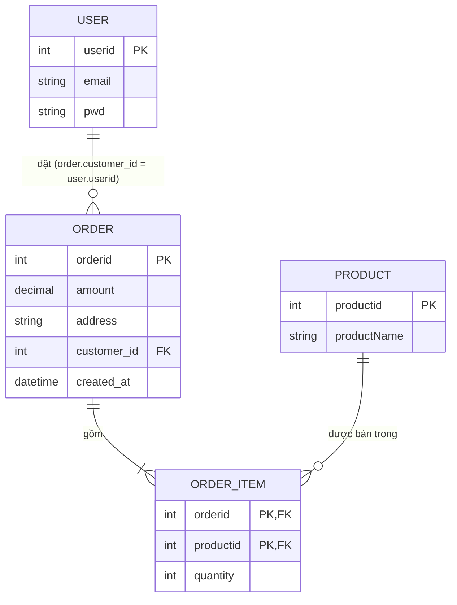

Giả sử mình có một hệ thống bán hàng khá lớn, khoảng 100 000 user. Ngoài user ra thì hệ thống còn có thêm các bảng product, order và order_item.

Các bảng mình dùng làm ví dụ sẽ có những cột như sau:
Bảng user: userid, email, pwd.
Bảng product: productid, productName.
Bảng order: orderid, customer_id, amount, address, created_at
Bảng order_item: orderid, productid, quantity.

Mình vẽ sơ đồ các bảng nối với nhau như thế nào (PK là khóa chính, FK là khóa ngoại):



- Nhìn sơ đồ thì dễ thấy: một user có thể đặt nhiều order, một order có nhiều order_item, và một product thì có thể nằm trong nhiều order_item.
- Bảng order_item là bảng nối giữa order và product.
- Cột customer_id trong order chính là khóa ngoại trỏ về userid của bảng user.
- Cột created_at trong order là thời điểm tạo đơn, mình dùng nó để sắp xếp đơn mới nhất lên trước.
- Một lưu ý nhỏ: trong các câu SQL bên dưới mình viết là `users` và `orders` (số nhiều), vì `order` là từ khóa của SQL nên không đặt tên bảng như vậy được.


# Real cases bổ sung
## Case 1. Đăng nhập bằng email

**Tình huống:** mỗi lần user đăng nhập thì hệ thống chạy câu này:
```sql
SELECT userid, pwd FROM users WHERE email = 'alice@example.com';
```
**Nếu không có index:** DB phải quét hết cả bảng `users` mỗi lần có người đăng nhập, user càng nhiều thì càng chậm.
**Cách giải quyết:** mình tạo một index B-tree trên một cột, và thường mình cho nó là unique luôn, vì email thì không được trùng nhau.
```sql
CREATE UNIQUE INDEX idx_users_email ON users (email);
```
**Vì sao chỉ cần một cột:** vì mình chỉ đi tìm đúng một giá trị là email thôi. Không có điều kiện nào khác đi kèm, nên không cần composite.

# Phần 2: Case thường gặp dùng composite
## Case 2 (phổ biến nhất). Trang "Đơn hàng của tôi"

**Tình huống:** khi người dùng vào trang đơn hàng thì mình hiển thị 20 đơn mới nhất. Bảng order có khoảng 200 000 đơn, nên mình vừa phải tìm đơn theo customer_id, vừa phải sắp xếp để đơn mới nhất lên đầu. Và trang này hiển thị **theo trang**: trang 1 là 20 đơn mới nhất, trang 2 là 20 đơn tiếp theo, trang 3 là 20 đơn tiếp nữa, cứ vậy.
```sql
-- Trang 1
SELECT orderid, amount, address, created_at
FROM orders
WHERE customer_id = 42
ORDER BY created_at DESC
LIMIT 20 OFFSET 0;

-- Trang 2
... ORDER BY created_at DESC LIMIT 20 OFFSET 20;

-- Trang 3
... ORDER BY created_at DESC LIMIT 20 OFFSET 40;
```
`LIMIT 20` là mỗi trang lấy 20 dòng, còn `OFFSET` là số dòng mình bỏ qua để nhảy tới đúng trang. Kiểu này mình gặp rất nhiều, gần như API danh sách nào cũng có, như đơn hàng, comment, thông báo, giao dịch.

**Bước 1: mới chỉ có index `(customer_id)`**
Mỗi lần mở một trang, kể cả trang 1, DB vẫn phải lấy **hết** đơn của khách đó, ví dụ 5 000 đơn, rồi **sort** theo `created_at`, sau đó mới cắt ra đúng 20 dòng của trang.
```
Limit
  -> Sort  (Sort Key: created_at DESC)
       -> Index Scan using idx_orders_customer
```
Khách càng nhiều đơn thì mở trang càng chậm, mà mỗi lần chuyển trang lại sort lại từ đầu.

**Bước 2: dùng composite `(customer_id, created_at)`**
```sql
CREATE INDEX idx_orders_customer_created ON orders (customer_id, created_at);
```
Lúc này, trong cùng một `customer_id`, dữ liệu đã được sắp sẵn theo `created_at`. DB đi tới khách 42, đọc ngược từ đơn mới nhất, bỏ qua số dòng của `OFFSET` rồi lấy 20 dòng cho trang. Mình không còn bước Sort nữa.
```
Limit
  -> Index Scan Backward using idx_orders_customer_created
```

**Vậy tại sao chọn composite mà không dừng ở index một cột:**

| | Index `(customer_id)` | Composite `(customer_id, created_at)` |
|---|---|---|
| Mở trang 1 | Lấy mọi đơn của khách rồi sort | Đọc 20 dòng đầu, không sort |
| Mở trang 2, 3... | Lấy mọi đơn rồi sort lại từ đầu | Đọc `OFFSET + 20` dòng đầu, không sort |
| Bước Sort | Có, ở mọi trang | Không |
| Khách có 50.000 đơn | Chậm rõ rệt ở mọi trang | Trang đầu vẫn nhanh như khách 50 đơn |

**Lưu ý về `OFFSET`:** composite giúp mình bỏ được bước Sort, nhưng nếu `OFFSET` lớn thì DB vẫn phải đi qua từng dòng bị bỏ qua, ví dụ trang 100 thì phải bỏ qua gần 2 000 dòng. Với trang "đơn của tôi" thì khách ít khi xem tới trang sâu, nên mình chấp nhận được. Còn với danh sách rất dài như feed hay log, mình nên phân trang theo cursor (keyset): trang sau lấy `created_at` của dòng cuối trang trước làm điểm bắt đầu.
```sql
SELECT orderid, amount, address, created_at
FROM orders
WHERE customer_id = 42 AND created_at < '2026-10-01 10:30:00'  -- created_at dòng cuối của trang trước
ORDER BY created_at DESC
LIMIT 20;
```
Cách này vẫn dùng đúng composite `(customer_id, created_at)`, và trang nào cũng nhanh như trang 1 vì không phải bỏ qua dòng nào. Còn nếu `created_at` có thể bị trùng thì mình thêm `orderid` vào cuối composite, và thêm vào điều kiện để phân biệt hai dòng.

**Sau khi có composite:** thường thì mình xóa được index `(customer_id)` luôn, vì cột đầu của composite đã đủ dùng rồi (leftmost prefix). Nhưng mình chỉ xóa sau khi dùng `EXPLAIN` kiểm tra xem mấy query cũ vẫn dùng composite.

## Case 3. Composite không thay được index một cột (leftmost prefix)

**Tình huống:** mình đã có `(customer_id, created_at)` từ Case 2. Sau đó admin cần một màn hình xem "tất cả đơn hôm nay" của mọi khách:
```sql
SELECT * FROM orders WHERE created_at >= current_date;
```
**Vấn đề:** composite sắp xếp theo `customer_id` trước. Mình bỏ qua cột đầu thì các đơn hôm nay nằm rải rác ở khắp các khách, giống như tra danh bạ theo tên mà không biết họ, phải lật hết. Lúc này `EXPLAIN` thường sẽ cho ra `Seq Scan`.

| Query | Dùng được `(customer_id, created_at)`? | Lý do |
|---|---|---|
| `WHERE customer_id = 42` | Có | Cột đầu |
| `WHERE customer_id = 42 AND created_at > ...` | Có | Đủ bộ key |
| `WHERE created_at >= current_date` | Thường không | Bỏ qua cột đầu |

**Cách xử lý:** mình thêm một index riêng trên một cột `(created_at)`.
**Vậy tại sao không đảo composite thành `(created_at, customer_id)`:** vì làm vậy sẽ hỏng Case 2, do range đứng trước equality, và màn hình "theo khách" cũng không dùng được index nữa. Hai nhu cầu khác nhau thì mình dùng hai index, đổi lại việc ghi dữ liệu sẽ chậm hơn một chút.
