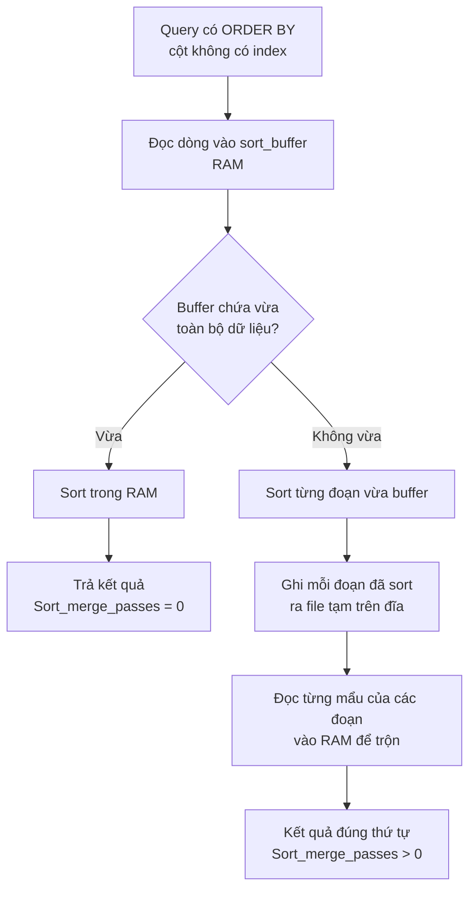

# Giải thích chi tiết: sort buffer và merge pass (MySQL)

Tài liệu giải thích sâu cho mục "Sort buffer và merge pass (MySQL)" trong [`README.md`](README.md). Ví dụ chạy thử nằm ở [`real_cases.md`](real_cases.md), Case 2.

## Mục lục
- [1. Hai thứ cần phân biệt](#1-hai-thứ-cần-phân-biệt)
- [2. Luồng sort](#2-luồng-sort)
- [3. Trộn các đoạn diễn ra thế nào](#3-trộn-các-đoạn-diễn-ra-thế-nào)
- [4. Vì sao có nhiều pass](#4-vì-sao-có-nhiều-pass)
- [5. `Sort_merge_passes`](#5-sort_merge_passes)
- [6. Vì sao không đặt buffer ở mức max cho cả server](#6-vì-sao-không-đặt-buffer-ở-mức-max-cho-cả-server)
- [7. File tạm](#7-file-tạm)

## 1. Hai thứ cần phân biệt

`sort_buffer_size` tương ứng với `work_mem` của PostgreSQL. Nó là **RAM**, không phải ổ đĩa tạm. Nó cũng **không phải cache**: chỉ là vùng làm việc tạm cho một lần sort, xong là bỏ.

| | Là gì | Nằm ở đâu |
|---|---|---|
| `sort_buffer_size` | Vùng nhớ MySQL dùng để sort | RAM |
| File tạm (temp file) | Nơi cất các đoạn đã sort khi RAM không đủ | Ổ đĩa |

## 2. Luồng sort



Ví dụ với 12 số, buffer chỉ chứa 4 số:

```
Dữ liệu gốc:  9  4  12  1  |  7  15  3  8  |  11  2  14  6

Bước 1: sort từng đoạn trong RAM rồi ghi ra đĩa
  Đoạn 1: [9, 4, 12, 1]    -> sort -> [1, 4, 9, 12]    (ghi ra file tạm)
  Đoạn 2: [7, 15, 3, 8]    -> sort -> [3, 7, 8, 15]    (ghi ra file tạm)
  Đoạn 3: [11, 2, 14, 6]   -> sort -> [2, 6, 11, 14]   (ghi ra file tạm)

Bước 2: trộn (mỗi lần lấy phần tử nhỏ nhất trong các đầu đoạn)
  Đầu đoạn:  1 | 3 | 2   -> lấy 1
  Đầu đoạn:  4 | 3 | 2   -> lấy 2
  Đầu đoạn:  4 | 3 | 6   -> lấy 3
  Đầu đoạn:  4 | 7 | 6   -> lấy 4
  ... cứ thế đến hết

Kết quả: 1 2 3 4 6 7 8 9 11 12 14 15
```

## 3. Trộn các đoạn diễn ra thế nào

Việc trộn diễn ra **trong RAM**, dùng chính `sort_buffer`. Dữ liệu nguồn nằm trên đĩa, nhưng phần so sánh và ghép làm trong bộ nhớ:

1. MySQL không nạp cả các đoạn vào RAM (vì RAM không đủ, đó là lý do mới phải chia đoạn).
2. Nó chia buffer thành các phần nhỏ, mỗi phần giữ một mẩu đầu của một đoạn đọc từ đĩa.
3. MySQL so các phần tử đầu của các mẩu trong RAM, lấy phần tử nhỏ nhất ra kết quả.
4. Khi một mẩu hết, MySQL đọc mẩu tiếp theo của đoạn đó từ đĩa vào.

```
Đĩa:  Đoạn 1 [3, 8, 15 ...]   Đoạn 2 [1, 9, 12 ...]   Đoạn 3 [...]
          \                      |                      /
           v                     v                     v
RAM:   [mẩu đầu đoạn 1] [mẩu đầu đoạn 2] [mẩu đầu đoạn 3]
                    so sánh, lấy nhỏ nhất ra
                              |
                              v
                         kết quả đúng thứ tự
```

## 4. Vì sao có nhiều pass

Số đoạn mà MySQL trộn được cùng lúc phụ thuộc vào kích thước buffer. Nếu có quá nhiều đoạn, MySQL trộn một nhóm đoạn thành một đoạn lớn hơn, ghi lại ra đĩa, rồi lặp lại cho đến khi còn ít đoạn đủ trộn lần cuối. Mỗi lượt như vậy là một merge pass.

Ví dụ buffer chỉ trộn được 4 đoạn cùng lúc, trong khi có 8 đoạn:

```
Có 8 đoạn trên đĩa:  [1] [2] [3] [4] [5] [6] [7] [8]

Pass 1: trộn 4 đoạn một lần, ghi lại ra đĩa
  [1][2][3][4]  ->  [A]
  [5][6][7][8]  ->  [B]

Pass 2: trộn 2 đoạn lớn còn lại
  [A][B]        ->  kết quả cuối cùng

Tổng: 2 pass, mỗi pass đọc và ghi lại dữ liệu qua đĩa (nên chậm).
Buffer lớn hơn -> trộn được nhiều đoạn một lúc, ít đoạn ngay từ đầu -> ít pass.
```

## 5. `Sort_merge_passes`

Bộ đếm trạng thái cho biết đã phải trộn bao nhiêu lượt.

| Giá trị | Ý nghĩa |
|---|---|
| 0 | Sort xong trong RAM, không dùng đĩa. |
| Lớn hơn 0 | Sort phải ghi và đọc file tạm trên đĩa. Càng lớn càng chậm. |

Cách đo một query:

```sql
FLUSH STATUS;                                    -- đưa bộ đếm của session về 0
SELECT id, bio FROM users ORDER BY bio;          -- chạy query cần đo
SHOW SESSION STATUS LIKE 'Sort_merge_passes';    -- số lượt trộn của query vừa chạy
```

Cần `FLUSH STATUS` trước để con số chỉ phản ánh query vừa chạy, không bị cộng dồn từ các query trước trong session.

Khi con số lớn: tăng `sort_buffer_size` cho session đó, hoặc tốt hơn là đánh index cho cột `ORDER BY` để MySQL không phải sort nữa.

## 6. Vì sao không đặt buffer ở mức max cho cả server

Buffer được cấp **mỗi connection, mỗi lần sort**, nên tổng RAM là `sort_buffer_size` × số connection đang sort. Ví dụ 256 MB × 200 connection có thể làm hết RAM. Chỉ tăng ở session chạy báo cáo nặng, xong thì trả lại:

```sql
SET SESSION sort_buffer_size = DEFAULT;
```

## 7. File tạm

- Nằm trong thư mục `tmpdir` (xem bằng `SHOW VARIABLES LIKE 'tmpdir';`), tên thường bắt đầu bằng `MY` rồi chuỗi ngẫu nhiên. Trên Linux thường không thấy được vì MySQL xóa tên file ngay sau khi tạo. Xong sort thì file bị bỏ.
- **Không có tham số giới hạn riêng** như `sort_buffer_size`, chỉ bị chặn bởi dung lượng trống của ổ chứa `tmpdir`. Đầy ổ thì query lỗi (`Errcode: 28 - No space left on device`). Nên đặt `tmpdir` sang ổ riêng đủ dung lượng nếu hay sort lớn.
- Đừng nhầm với bảng tạm nội bộ (`#sql...`, `ibtmp1`) dùng cho `GROUP BY`, `DISTINCT`, `UNION`: loại này có giới hạn riêng (`tmp_table_size`, `max_heap_table_size`).

Chi tiết nội bộ (cách chia buffer, tên file, cách ẩn file) là hiểu biết chung về external merge sort và MySQL 8.0, chưa kiểm tra trên từng phiên bản.
