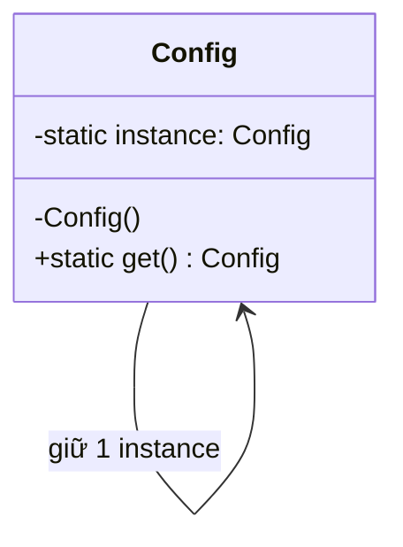
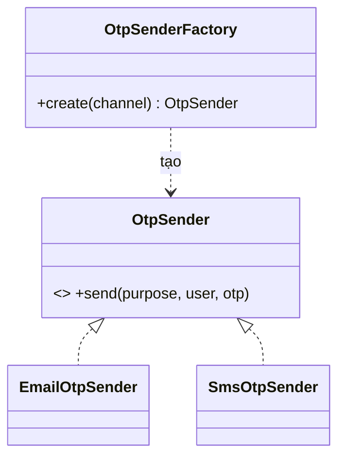
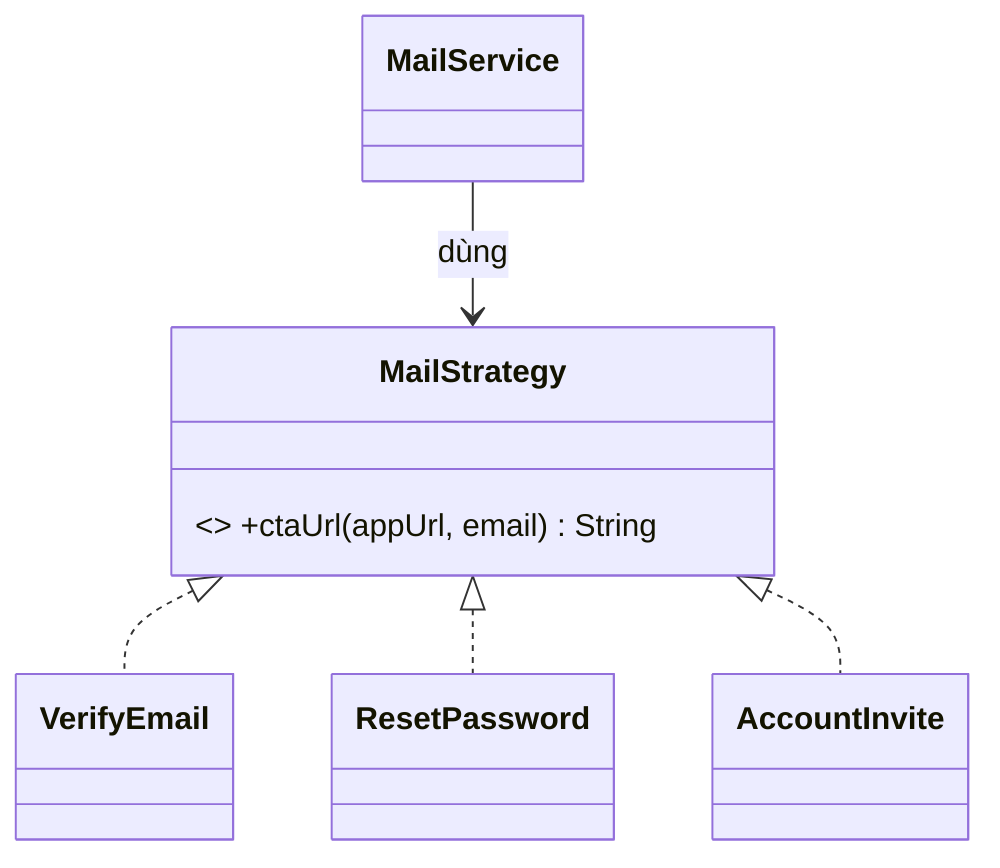
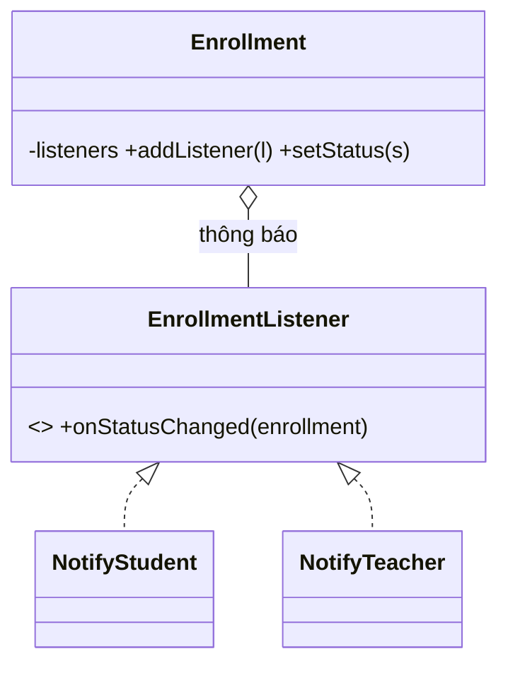
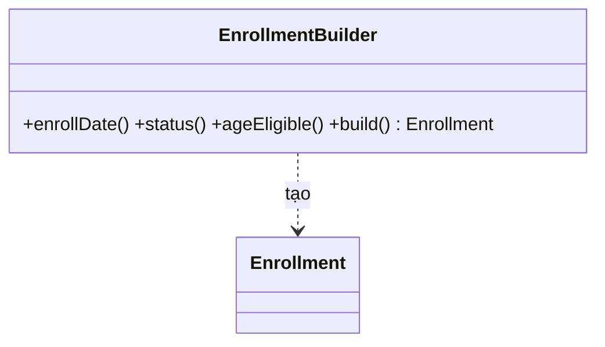
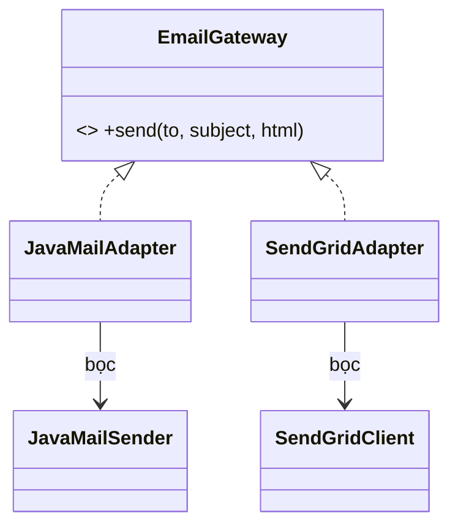
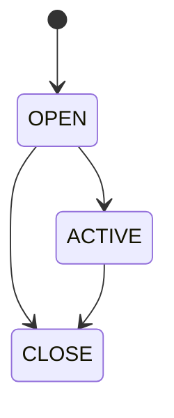

# Algorithm

- **Domain:** REST API
- **Week:** Week 5-6

## Mục lục
- [Algorithm](#algorithm)
  - [Mục lục](#mục-lục)
  - [Reference](#reference)
  - [Key concepts](#key-concepts)
    - [Design pattern là gì](#design-pattern-là-gì)
    - [1. Singleton](#1-singleton)
    - [2. Factory Method](#2-factory-method)
    - [3. Strategy](#3-strategy)
    - [4. Observer](#4-observer)
    - [5. Builder](#5-builder)
    - [6. Adapter](#6-adapter)
    - [7. State](#7-state)
    - [Tổng hợp](#tổng-hợp)
  - [Q\&A](#qa)
  - [Hands-on](#hands-on)
  - [Done](#done)
  - [Slide](#slide)

## Reference
- [The 7 most important software design patterns](https://www.educative.io/blog/the-7-most-important-software-design-patterns)

## Key concepts

Các ví dụ lấy từ project `english-center-system-clean`. Code là Java rút gọn, chỉ để thấy ý tưởng. Chỗ nào project chưa có thì ghi là đề xuất. Chi tiết từng case xem [real_cases.md](real_cases.md).

### Design pattern là gì
- Là những mẫu thiết kế có sẵn để giải quyết những vấn đề chúng ta hay gặp.

Cách học design pattern:
- Xem context, UML, code example
- Phải nhớ pattern giải quyết vấn đề gì
- Học và tìm hiểu pattern trong framework
- Áp dụng vào thực tế

- Lợi ích: team nói "dùng Strategy" là ai cũng hiểu ngay, khỏi giải thích dài.
- Lưu ý: không có vấn đề thật mà vẫn dùng pattern thì code chỉ rối thêm.

### 1. Singleton
- **Khái niệm:** Singleton pattern là một design pattern mà toàn bộ hệ thống chỉ có một bản. Nếu hệ thống có nhiều bản thì tốn tài nguyên, và các bản có thể khác nhau về giá trị. Ví dụ: config dự án, kết nối với mail service, kết nối đến DB.
- **Vấn đề:** nếu mỗi nơi trong hệ thống tự tạo kết nối riêng đến mail hay đến DB thì tốn tài nguyên, và không đảm bảo mọi nơi dùng cùng một cấu hình, cùng một trạng thái (ví dụ có bản đã đọc config mới, có bản vẫn giữ config cũ).



- **Cách giải:** chỉ tạo đúng 1 object, ai cần thì lấy lại chính object đó.
```java
class Config {
    private static Config instance;
    private Config() {}                       // private: bên ngoài không `new` được

    static synchronized Config get() {        // lần đầu tạo, các lần sau trả lại cái cũ
        if (instance == null) instance = new Config();
        return instance;
    }
}

Config.get() == Config.get(); // true: cùng một object
```
- **Khi dùng:** config, cache, connection pool.
- **Lưu ý:** dùng nhiều thì thành biến global trá hình, khó test.
- **Trong framework:** Spring bean mặc định là singleton (mọi `@Service`/`@Component` chỉ có một bản). JDK: `Runtime.getRuntime()`.

- Real case: [real_cases.md, Case 1](real_cases.md#case-1-singleton-mailservice-dùng-chung), [Case 2](real_cases.md#case-2-singleton-một-datasource-cho-cả-app)

### 2. Factory Method
- **Khái niệm:** Factory Method là một design pattern: thay vì viết `if/else` rồi chọn đối tượng ở nhiều nơi, ta tạo một class có một hàm chung làm việc đó. Nơi nào cần thì gọi hàm này và truyền giá trị phù hợp để nhận về đối tượng tương ứng (có thể là `new` mới, hoặc bean có sẵn do Spring quản lý). Khi thêm, xóa hoặc sửa một loại thì chỉ sửa ở một chỗ, không phải sửa nhiều nơi.
- **Vấn đề:** code phải tạo object thuộc nhiều loại tùy điều kiện. Nếu chỗ nào cũng tự `if/else` rồi `new` thì thêm loại mới phải sửa khắp nơi.



- **Cách giải:** gom việc "chọn và tạo object" vào một hàm. Chỗ khác chỉ gọi hàm đó, không cần biết class cụ thể.
- **Trong Spring (collection injection):** inject `Map<String, T>` (key là tên bean) hoặc `List<T>` chứa tất cả bean cùng kiểu, rồi tra theo giá trị thay cho `if/else`. Nếu key là enum thì tự dựng map từ `List<T>`.
- Real case: [real_cases.md, Case 3](real_cases.md#case-3-factory-method-chọn-kênh-gửi-otp), [Case 4](real_cases.md#case-4-factory-method-hmac-của-jdk)

### 3. Strategy
- **Khái niệm:** Strategy dùng khi cùng một công việc nhưng có nhiều cách làm (mục đích giống nhau, cách làm và kết quả khác nhau). Mỗi cách viết thành một class riêng, rồi dựa vào tham số để chọn cách làm tương ứng thay vì `if/else`. 

> **Lưu ý:** chỉ dùng khi `switch`/`if-else` dài, hay thêm nhánh mới, mỗi nhánh có logic thật. Ít nhánh, cố định thì giữ `switch`.

- **Vấn đề:** cùng một việc nhưng có nhiều cách làm. Nhét hết vào một hàm toàn `if/else` thì thêm cách mới phải sửa hàm cũ, dễ làm hỏng nhánh đang chạy.



- **Cách giải:** mỗi cách tính là một hàm riêng, cùng dạng đầu vào/đầu ra, rồi chọn cái cần dùng lúc chạy.
```java
interface MailStrategy { String ctaUrl(String appUrl, String email); }
class VerifyEmail   implements MailStrategy { public String ctaUrl(String u, String e) { return u + "/auth/verify-email?email=" + e; } }
class ResetPassword implements MailStrategy { public String ctaUrl(String u, String e) { return u + "/auth/forgot-password"; } }
class AccountInvite implements MailStrategy { public String ctaUrl(String u, String e) { return u + "/auth/forgot-password?email=" + e; } }

Map<Kind, MailStrategy> strategies = Map.of(
    Kind.VERIFY_EMAIL, new VerifyEmail(),
    Kind.RESET_PASSWORD, new ResetPassword(),
    Kind.ACCOUNT_INVITE, new AccountInvite());

String url = strategies.get(kind).ctaUrl(appUrl, email); // thêm loại mail mới: thêm 1 class + 1 dòng trong map
```
- **Phân biệt với Factory:** Factory chọn "tạo object nào", Strategy chọn "làm theo cách nào".
- **Cách chọn:** thường dùng một `Map` (key là giá trị truyền vào, value là cách làm), hoặc đưa thẳng cách làm vào hàm như `list.sort(comparator)`. Mỗi cách làm có thể chỉ là một hàm (lambda) thay vì class, nếu ngắn và chỉ có một hàm.
- **Trong framework:** `Comparator` truyền vào `list.sort(...)`. Spring Security: `PasswordEncoder` (BCrypt, Argon2... cùng interface).
- **Trong project:** chưa có chỗ hợp lý. `MailService.java:77-81` chỉ có `switch` 3 case và chỉ khác dữ liệu nên giữ `switch`.

- Real case: [real_cases.md, Case 5](real_cases.md#case-5-strategy-các-loại-mail-otp), [Case 6](real_cases.md#case-6-strategy-luật-xét-điều-kiện-ghi-danh)

### 4. Observer
- **Vấn đề:** khi một object thay đổi, nhiều nơi khác cần biết. Nếu object đó gọi thẳng từng nơi thì thêm nơi mới phải sửa object đó, và nó bị dính chặt vào các nơi kia.



- **Cách giải:** các bên "đăng ký" lắng nghe. Enrollment đổi trạng thái thì chỉ việc phát tín hiệu, ai đã đăng ký sẽ tự chạy.
```java
interface EnrollmentListener { void onStatusChanged(Enrollment enrollment); }

class Enrollment {
    private final List<EnrollmentListener> listeners = new ArrayList<>();
    private String status;

    void addListener(EnrollmentListener l) { listeners.add(l); }

    void setStatus(String status) {
        this.status = status;
        listeners.forEach(l -> l.onStatusChanged(this)); // báo cho tất cả bên đã đăng ký
    }
}

enrollment.addListener(e -> notifyStudent(e));
enrollment.addListener(e -> notifyTeacher(e));
enrollment.setStatus("CANCELLED"); // cả hai listener tự chạy, Enrollment không biết chúng làm gì
```
- **Giống:** follow một người trên Twitter, có bài mới thì tự nhận thông báo.
- **Trong framework:** Spring `ApplicationEventPublisher.publishEvent(...)` và `@EventListener`.
- **Trong project:** chưa có (không có `@EventListener` hay `publishEvent`).
- **Có thể áp dụng trong project (đề xuất):** `AuthServiceImpl.java:146-148` sau khi lưu user gọi tuần tự hai việc, có thể phát event `UserRegistered` cho các listener (xem Case 7, 8).

- Real case: [real_cases.md, Case 7](real_cases.md#case-7-observer-gửi-mail-sau-khi-tạo-otp), [Case 8](real_cases.md#case-8-observer-user-đăng-ký)

### 5. Builder
- **Vấn đề:** object có nhiều thông tin, trong đó nhiều cái tùy chọn. Constructor dài rất khó đọc, dễ nhầm thứ tự tham số.



- **Cách giải:** dựng object từng bước, mỗi bước có tên rõ ràng, cuối cùng gọi `build()`.
```java
class Enrollment {
    private final Student student;
    private final Course course;
    private final LocalDate enrollDate;
    private final String status;
    private final Boolean ageEligible;

    private Enrollment(Builder b) {
        student = b.student; course = b.course; enrollDate = b.enrollDate;
        status = b.status; ageEligible = b.ageEligible;
    }

    static class Builder {
        private final Student student;
        private final Course course;
        private LocalDate enrollDate = LocalDate.now();
        private String status = "ACTIVE";
        private Boolean ageEligible;

        Builder(Student student, Course course) { this.student = student; this.course = course; }
        Builder enrollDate(LocalDate d)  { enrollDate = d; return this; }
        Builder status(String s)         { status = s; return this; }
        Builder ageEligible(Boolean b)   { ageEligible = b; return this; }

        Enrollment build() {
            if (student == null || course == null) throw new IllegalStateException("Enrollment needs student and course"); // field bắt buộc
            return new Enrollment(this);
        }
    }
}

Enrollment enrollment = new Enrollment.Builder(student, course)
    .enrollDate(LocalDate.now())
    .status("ACTIVE")
    .ageEligible(true)
    .build();
```
- **Trong framework:** `StringBuilder`, `HttpRequest.newBuilder()`, Lombok `@Builder`.
- **Trong project:** có, dùng Lombok `@Builder` (Lombok sinh sẵn): `EnrollmentServiceImpl.java:125-134` dựng `Enrollment` bằng `Enrollment.builder()` với 8 field, và `ErrorResponse.java:11`.

- Real case: [real_cases.md, Case 9](real_cases.md#case-9-builder-tạo-enrollment), [Case 10](real_cases.md#case-10-builder-errorresponse)

### 6. Adapter
- **Vấn đề:** thư viện hoặc hệ thống bên ngoài có cách gọi khác với cách code mình mong muốn. Gọi trực tiếp ở khắp nơi thì khi đổi bên ngoài phải sửa khắp nơi.



- **Cách giải:** viết lớp "đầu chuyển" cho mỗi thư viện, cùng một cách gọi. App chỉ gọi đầu chuyển, đổi vendor chỉ đổi đầu chuyển.
```java
interface EmailGateway { void send(String to, String subject, String html); } // cách gọi mà app mong muốn

class JavaMailAdapter implements EmailGateway {
    private final JavaMailSender sender;     // thư viện bên ngoài, cách gọi riêng
    JavaMailAdapter(JavaMailSender s) { sender = s; }
    public void send(String to, String subject, String html) { /* createMimeMessage, setTo, setText, sender.send */ }
}

class SendGridAdapter implements EmailGateway {
    private final SendGridClient client;     // thư viện khác, cách gọi khác (tên minh họa)
    SendGridAdapter(SendGridClient c) { client = c; }
    public void send(String to, String subject, String html) { client.sendMail(to, subject, html); }
}

EmailGateway gateway = new SendGridAdapter(client);  // đổi vendor: chỉ đổi dòng này
gateway.send(email, "Verify your email", html);      // app luôn gọi một kiểu
```
- **Giống:** ổ cắm chuyển đổi khi đi du lịch.
- **Trong framework:** `Arrays.asList(array)` (đưa mảng về `List`), `InputStreamReader` (đưa byte stream về character stream), Spring MVC `HandlerAdapter`.
- **Trong project:** chưa có.
- **Có thể áp dụng trong project (đề xuất):** `MailService.java:85-101` gọi thẳng `JavaMailSender`, có thể bọc sau `EmailGateway` để sau này đổi nhà cung cấp mail chỉ thêm một adapter (xem Case 11, 12).

- Real case: [real_cases.md, Case 11](real_cases.md#case-11-adapter-gửi-mail-qua-javamailsender), [Case 12](real_cases.md#case-12-adapter-gửi-mail-ở-môi-trường-dev)

### 7. State
- **Vấn đề:** hành vi của object phụ thuộc trạng thái hiện tại, có thao tác chỉ hợp lệ ở một số trạng thái. Kiểm tra bằng `if` rải khắp nơi thì dễ sót và cho phép thao tác sai.



- **Cách giải:** quy định rõ mỗi trạng thái được chuyển sang trạng thái nào, và hành vi nằm ở trạng thái đó.
```java
enum CourseStatus {
    OPEN, ACTIVE, CLOSE;

    boolean canMoveTo(CourseStatus target) {       // luật chuyển là giả định minh họa
        return switch (this) {
            case OPEN   -> target == ACTIVE || target == CLOSE;
            case ACTIVE -> target == CLOSE;
            case CLOSE  -> false;                  // kết thúc
        };
    }
}

if (!course.getStatus().canMoveTo(target)) {
    throw new IllegalStateException(course.getStatus() + " -> " + target + " is not allowed");
}
```
- **Lưu ý:** đây là bản rút gọn dùng `enum`. Bản đầy đủ của pattern là mỗi trạng thái một class riêng, mỗi class tự xử lý hành vi của trạng thái đó.
- **Trong framework:** thư viện Spring Statemachine (JDK không có sẵn).
- **Trong project:** chưa có State đúng nghĩa. `CourseStatus` (`OPEN/CLOSE/ACTIVE`) mới chỉ là enum, `CourseServiceImpl.java:161` gán thẳng `course.setStatus(request.status())` mà không kiểm tra luồng chuyển, đây là chỗ có thể áp dụng State (xem Case 13, 14).

- Real case: [real_cases.md, Case 13](real_cases.md#case-13-state-trạng-thái-khóa-học), [Case 14](real_cases.md#case-14-state-trạng-thái-ghi-danh)

### Tổng hợp
| Pattern | Nhóm | Dùng khi |
|---|---|---|
| Singleton | Creational | Cần đúng 1 object dùng chung (config, pool) |
| Factory Method | Creational | Tạo object theo lựa chọn, không muốn code phụ thuộc class cụ thể |
| Builder | Creational | Object có nhiều tham số, dựng từng bước |
| Adapter | Structural | Nối hai thứ có cách gọi khác nhau (đổi vendor) |
| Strategy | Behavioral | Cùng việc nhưng nhiều cách làm, chọn lúc chạy |
| Observer | Behavioral | Một thay đổi cần báo cho nhiều bên |
| State | Behavioral | Hành vi phụ thuộc trạng thái, bỏ if-else |

- App thật dùng kết hợp nhiều pattern (app giao đồ ăn trong bài dùng cả 7). Mục tiêu là code dễ bảo trì, dễ mở rộng, không phải dùng càng nhiều càng tốt.
- Cách phân nhóm Creational/Structural/Behavioral là theo Gang of Four, bài gốc không ghi.

## Q&A
- 

## Hands-on
- [ ] 

## Done
- [ ] Read reference
- [ ] Notes written
- [ ] Practice done

## Slide
- Link: 
